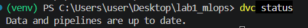
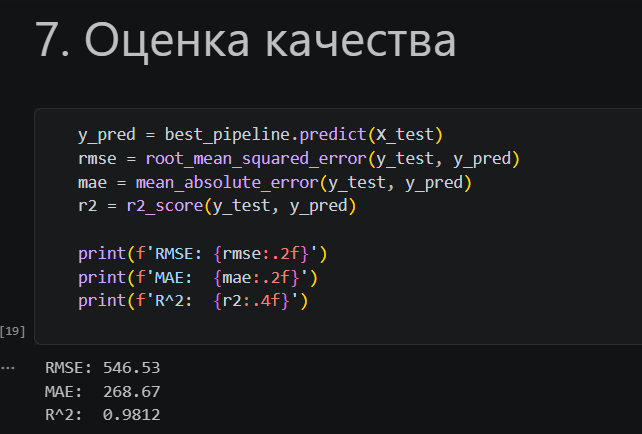

# Лабораторная работа 1: Введение и воспроизводимость исследований

* **Вариант**: № 9
* **Датасет**: Diamonds
* **Задача**: Регрессия (прогнозирование стоимости бриллианта)
* **Целевая переменная**: `price`

---

## 1. Структура проекта

Проект организован в соответствии с практиками воспроизводимости исследований и шаблоном Cookiecutter Data Science:

```text
├── data/
│   ├── raw/
│   │   ├── diamonds.csv           # Исходный датасет с внесенными пропусками (под DVC)
│   │   └── diamonds.csv.dvc       # DVC-указатель версии данных
│   └── processed/                 # Промежуточные и очищенные данные
├── models/
│   └── pipeline.joblib            # Сериализованный обученный конвейер с лучшими гиперпараметрами
├── notebooks/
│   └── 01_lab1_diamonds.ipynb     # Jupyter-ноутбук с конвейером, обучением и валидацией
├── reports/
│   └── figures/                   # Скриншоты и графики для отчёта
├── src/
│   ├── data/
│   │   └── make_dataset.py        # Скрипт внесения искусственных пропусков (10%)
│   └── features/
│       └── transformers.py        # Кастомный трансформер CutOrdinalEncoder
├── .gitignore                     # Исключения для Git
├── README.md                      # Отчёт о выполнении работы
└── requirements.txt               # Фиксация версий библиотек
```

---

## 2. Воспроизводимость окружения

1. **Создание и активация виртуального окружения**:
   ```bash
   python -m venv .venv
   # Windows:
   .venv\Scripts\activate
   # Linux / macOS:
   source .venv/bin/activate
   ```

2. **Установка зависимостей**:
   Все используемые библиотеки зафиксированы в `requirements.txt`:
   ```bash
   pip install -r requirements.txt
   ```

---

## 3. Подготовка данных и версионирование (DVC)

1. **Внесение пропусков**:
   Исходный датасет *Diamonds* не содержит пропусков. В соответствии с требованиями лабораторной работы был реализован скрипт `src/data/make_dataset.py`, который вносит ровно 10% случайных пропусков (MCAR) в две числовые колонки (`carat` и `depth`) с фиксированным сидом (`seed=42`).
   
   Запуск скрипта подготовки:
   ```bash
   python -m src.data.make_dataset
   ```

2. **Контроль версий данных**:
   Файл `data/raw/diamonds.csv` исключён из Git и помещён под управление **DVC** (`dvc add data/raw/diamonds.csv`), а в Git закоммичен файл-указатель `diamonds.csv.dvc`.

> ### Скриншот 1: Статус DVC
> 

---

## 4. Конвейер предобработки и модель

Весь цикл преобразования данных и обучения упакован в единый конвейер `sklearn.pipeline.Pipeline`, исключающий утечку данных (data leakage):

1. **Кастомный трансформер (`CutOrdinalEncoder`)**:
   * Размещён в `src/features/transformers.py`, унаследован от `BaseEstimator` и `TransformerMixin`.
   * Выполняет порядковое кодирование признака качества огранки `cut` в числовые значения по возрастанию качества:
     `Fair: 0`, `Good: 1`, `Very Good: 2`, `Premium: 3`, `Ideal: 4`.

2. **`ColumnTransformer`**:
   * **Числовые признаки** (`carat`, `depth`, `table`, `x`, `y`, `z`, а также закодированный `cut`):
     * Импутация пропусков: `SimpleImputer(strategy='median')`.
     * Масштабирование: `StandardScaler()`.
   * **Категориальные признаки** (`color`, `clarity`):
     * Импутация пропусков: `SimpleImputer(strategy='most_frequent')`.
     * Кодирование: `OneHotEncoder(handle_unknown='ignore', sparse_output=False)`.

3. **Модель и подбор гиперпараметров**:
   * В качестве модели выбран ансамбль деревьев решений `RandomForestRegressor(random_state=42)`.
   * Подбор гиперпараметров производился с помощью `GridSearchCV` по сетке (`n_estimators`, `max_depth`, `min_samples_split`) на 3 фолдах кросс-валидации с метрикой `neg_root_mean_squared_error`.
   * Финальный обученный пайплайн сохранён в `models/pipeline.joblib`.

---

## 5. Результаты и метрики

Данные были разделены на обучающую и тестовую выборки в пропорции **80/20** с фиксированным `random_state=42`. Оценка качества лучшей модели проводилась на отложенной тестовой выборке:

| Метрика | Значение на тесте |
|---|---|
| **RMSE** (Root Mean Squared Error) | **548.61** |
| **MAE** (Mean Absolute Error) | **269.59** |
| **$R^2$** (Коэффициент детерминации) | **0.9811** |

> ### Скриншот 2: Оценка качества модели и вывод метрик
> 

---

## 6. Выводы

1. Была настроена воспроизводимая структура проекта в соответствии со стандартами разработки Data Science-решений.
2. Организовано раздельное версионирование исходного кода (Git) и тяжелых данных (DVC).
3. Создан модульный конвейер обработки данных с включением собственного трансформера `CutOrdinalEncoder`, который корректно работает внутри `Pipeline` и `ColumnTransformer` без утечки данных.
4. Модель случайного леса продемонстрировала высокую точность аппроксимации стоимости ($R^2 \approx 0.98$), доказав устойчивость конвейера к пропускам в признаках.