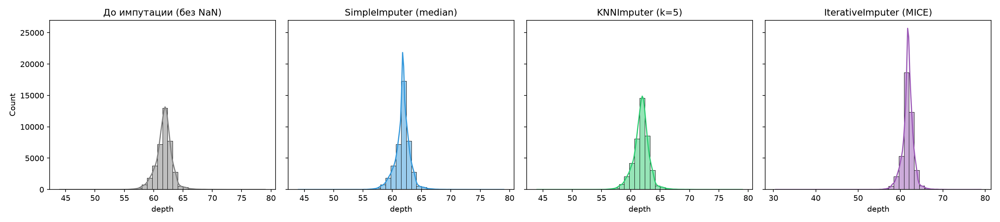
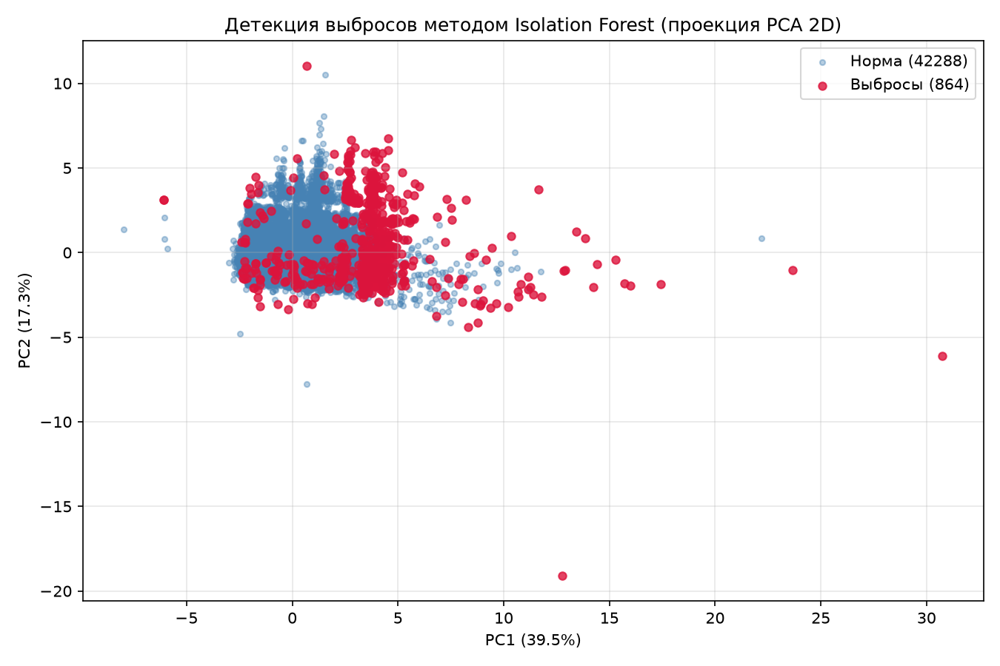
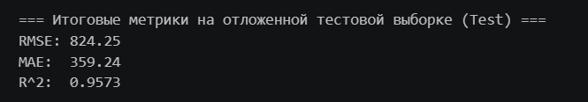

# Продвинутая инженерия признаков, импутация и детекция аномалий (Dataset Diamonds)

## 1. Цель исследования

Разработать и исследовать методы повышения качества данных и информативности признакового пространства в конвейере машинного обучения для задачи прогнозирования стоимости бриллиантов (`price`):
- Исследовать влияние механизмов пропусков и сравнить методы статистической и модельной импутации (`SimpleImputer`, `KNNImputer`, `IterativeImputer`).
- Реализовать автоматическую детекцию многомерных выбросов методом `Isolation Forest` с фильтрацией обучающей выборки внутри конвейера (`imblearn.pipeline.Pipeline`).
- Выполнить доменную генерацию нелинейных признаков, а также автоматический синтез реляционных признаков методом Deep Feature Synthesis (`Featuretools`).
- Сравнить фильтрационные и встроенные методы отбора признаков (`Mutual Information` и `RandomForest Feature Importances`).

---

## 2. Подготовка данных и моделирование искажений (DVC)

В рамках исследования на базе исходного набора данных **Diamonds** (`53 940` записей) сформирован модифицированный датасет `data/raw/diamonds_fe.csv`, поставленный под версионный контроль **DVC**:
1. **Моделирование пропусков (механизм MCAR — Missing Completely At Random)**:
   - В числовые признаки внесены случайные пропуски, вероятность появления которых не зависит ни от наблюдаемых, ни от скрытых параметров объекта.
2. **Моделирование выбросов**:
   - В 0.5% записей по ключевым геометрическим и весовым характеристикам (`carat`, `table`, `x`) внесены синтетические экстремальные аномалии (множитель от `5.0` до `10.0`).
3. **Разбиение выборки**:
   - Обучающая выборка (`X_train`): `43 152` объекта, `10` признаков.
   - Тестовая выборка (`X_test`): `10 788` объектов, `10` признаков (`random_state=42`).

---

## 3. Сравнение методов импутации пропусков

Для восстановления пропущенных значений в числовых признаках протестированы три подхода внутри изолированного `Pipeline` (с предварительным масштабированием `StandardScaler` и базовым регрессором `RandomForestRegressor` на 5-фолдовой кросс-валидации):

| Метод импутации | CV RMSE (mean) | CV RMSE (std) | Особенности подхода |
| :--- | :---: | :---: | :--- |
| **SimpleImputer (median)** | 592.17 | 27.88 | Быстрая замена медианой без учёта корреляций между признаками |
| **KNNImputer (k=5)** | **587.81** | **24.32** | Восстановление по 5 ближайшим соседям в масштабированном пространстве |
| **IterativeImputer (MICE)** | 593.75 | 24.52 | Итеративное предсказание пропусков как функции остальных признаков |

**Вывод по импутации:** Наилучшее качество и наименьший разброс ошибки на кросс-валидации показал **`KNNImputer (k=5)`** (`RMSE = 587.81`). Поскольку вес (`carat`) и физические габариты бриллианта (`x`, `y`, `z`, `depth`, `table`) тесно связаны геометрически, поиск ближайших соседей точнее восстанавливает утраченные значения, чем одномерная медиана, не создавая искусственного пика в центре распределения.

> ### График 1: Распределение признака `depth` до и после импутации
> 

---

## 4. Детекция и фильтрация выбросов (Isolation Forest)

Для обнаружения аномалий в многомерном пространстве числовых признаков применён алгоритм **`Isolation Forest`** с порогом загрязнения `contamination=0.02`:
- На обучающей выборке из `43 152` объектов классифицировано **`42 288` нормальных записей** и **`864` аномалии (выброса)**.
- Для визуализации выполнено снижение размерности методом главных компонент (**PCA**) до 2D (первая компонента `PC1` объясняет `38.0%` дисперсии, вторая `PC2` — `18.4%`). На графике отчётливо видно, что алгоритм изолирует периферийные объекты с нарушенными пропорциями.
- Для предотвращения утечки данных (data leakage) и сохранения целостности тестовой выборки разработан кастомный сэмплер `IsolationForestOutlierRemover`, работающий через метод `fit_resample` внутри `imblearn.pipeline.Pipeline`. Выбросы удаляются исключительно из `X_train` и `y_train` на этапе обучения, а на этапе инференса (`predict`) конвейер обрабатывает все тестовые объекты без потерь.

> ### График 2: Визуализация выбросов методом Isolation Forest в проекции PCA (2D)
> 

---

## 5. Генерация и отбор признаков

### 5.1. Доменная генерация признаков (`DiamondFeatureGenerator`)
В основной конвейер добавлен трансформер, синтезирующий нелинейные и физические характеристики камня:
- `volume = x * y * z` — аппроксимация физического объёма кристалла.
- `carat_sq = carat ** 2` — учёт квадратичной зависимости цены от веса бриллианта.
- `depth_table_ratio = depth / table` — геометрическое соотношение глубины к ширине площадки.

### 5.2. Сравнение методов отбора признаков
Проведено сравнение четырёх конфигураций конвейера на 5 фолдах кросс-валидации:
1. **Baseline** (без генерации и отбора признаков).
2. **Полный набор сгенерированных признаков** (`DiamondFeatureGenerator` без усечения).
3. **Фильтрационный метод**: `SelectKBest` на базе взаимной информации (`mutual_info_regression`, `k=15`).
4. **Встроенный (Embedded) метод**: `SelectFromModel` на базе важности признаков ансамбля `RandomForestRegressor` (`threshold='median'`).

| Конфигурация пайплайна | CV RMSE | Влияние на качество |
| :--- | :---: | :--- |
| **1. Без генерации и отбора (Baseline)** | 644.93 | Базовый ориентир на зашумлённых данных |
| **2. С генерацией признаков (все признаки)** | **644.41** | **Лучший результат (снижение ошибки за счёт нелинейных фичей)** |
| **3. Отбор: Mutual Information (`SelectKBest k=15`)** | 972.22 | Падение качества из-за отсечения части One-Hot категорий |
| **4. Отбор: Важности RandomForest (`SelectFromModel`)** | 709.57 | Превосходит фильтр MI на 262.65 п. за счёт учёта взаимодействий |

**Вывод по генерации и отбору:**
- Добавление геометрических и полиномиальных признаков (`volume`, `carat_sq`, `depth_table_ratio`) улучшает обобщающую способность модели (`CV RMSE = 644.41`).
- Встроенный отбор по важностям `RandomForest` (`709.57`) значительно эффективнее одномерного фильтра взаимной информации (`972.22`), так как оценивает вклад признаков в контексте древесных разбиений. При этом для `RandomForestRegressor` агрессивное сокращение признакового пространства не требуется: после One-Hot кодирования цвета (`color`) и чистоты (`clarity`) каждая бинарная колонка несёт важную ценовую поправку, и их принудительное отбрасывание снижает точность прогноза.

---

## 6. Финальный пайплайн и оценка на тестовой выборке

Итоговый конвейер объединяет все этапы обработки:
1. Порядковое кодирование качества огранки (`CutOrdinalEncoder`).
2. Масштабирование и импутация числовых признаков + One-Hot кодирование категориальных (`ColumnTransformer`).
3. Фильтрация многомерных аномалий на обучающей выборке (`IsolationForestOutlierRemover`).
4. Генерация нелинейных признаков (`DiamondFeatureGenerator`) и отбор информативных компонент.
5. Обучение финального ансамбля `RandomForestRegressor(n_estimators=100, max_depth=20, min_samples_split=5)`.

### Метрики на отложенной тестовой выборке (`X_test`):
- **RMSE**: `824.25`
- **MAE**: `359.24`
- **$R^2$ (Коэффициент детерминации)**: `0.9573`

> ### Скриншот 1: Результаты сравнения конфигураций и финальные метрики
> 

Сериализованный конвейер сохранён в `models/pipeline_fe2.joblib`.

---

## 7. Общие выводы

1. **Импутация**: Учёт структуры локального соседства (`KNNImputer`) обеспечил наилучшую точность восстановления пропусков (`RMSE = 587.81`), превзойдя базовую медианную импутацию и линейный итеративный метод MICE.
2. **Устойчивость к выбросам**: Применение `Isolation Forest` внутри `imblearn.pipeline.Pipeline` позволило автоматически очистить обучающую выборку от 2% наиболее экстремальных аномалий без нарушения методологии валидации. Более высокое значение RMSE на отложенной выборке (`824.25` при высоком $R^2 = 0.9573$) объясняется тем, что синтетические выбросы в тестовом наборе при оценке не удаляются, а квадратичная метрика RMSE сильно штрафует за экстремальные отклонения.
3. **Инженерия и отбор признаков**: Доменные признаки объёма и нелинейного веса дают прямой прирост точности, тогда как жёсткое сокращение размерности (`SelectKBest`) на табличных данных с важными категориальными признаками (`clarity`, `color`) приводит к потере полезного сигнала.