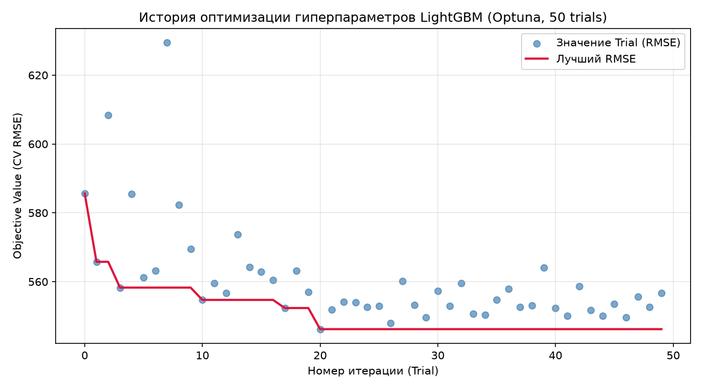
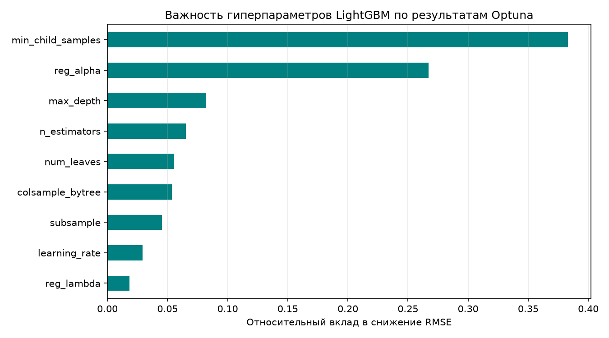
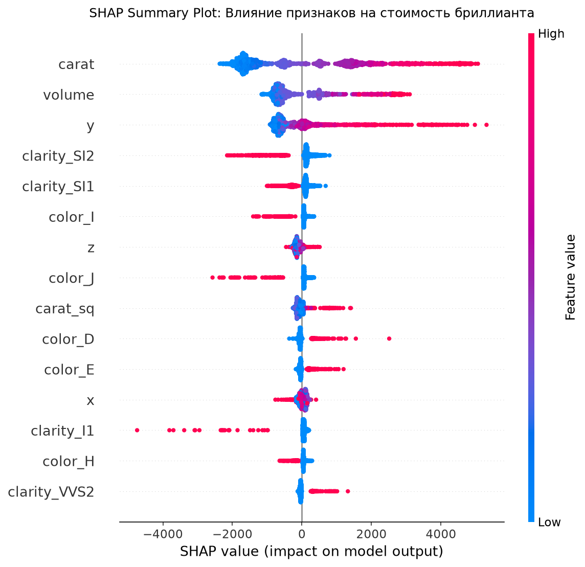
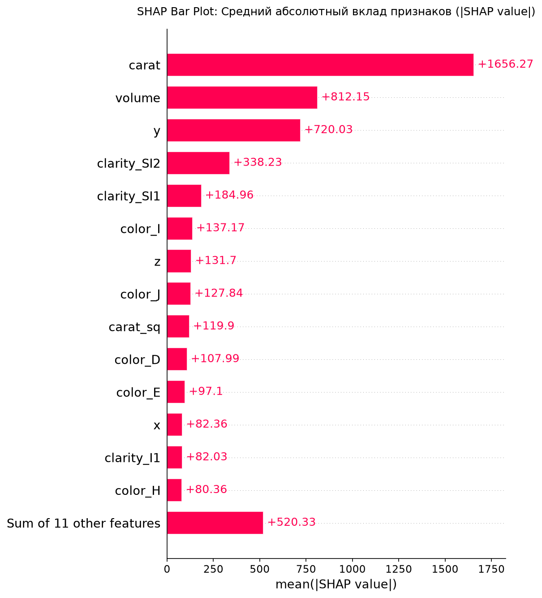
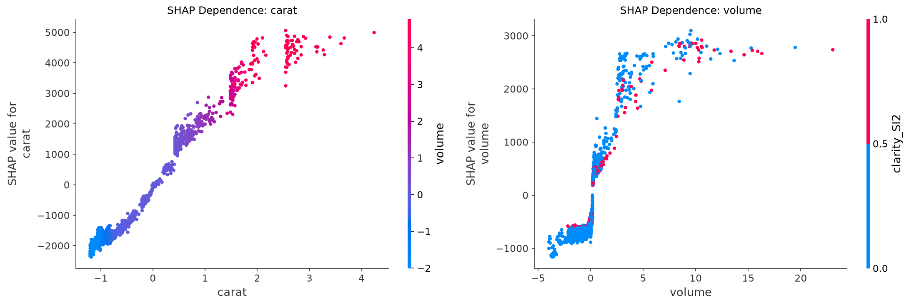
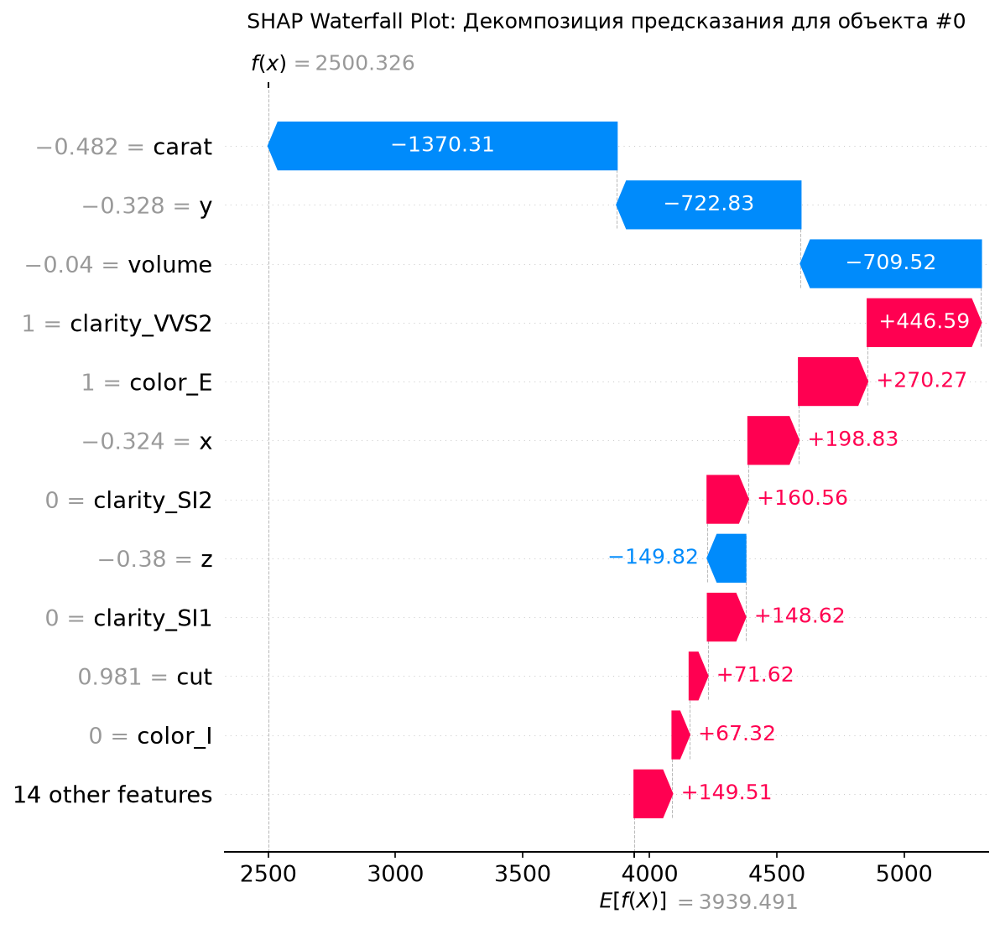

# Продвинутые модели машинного обучения, оптимизация гиперпараметров и интерпретация (Dataset Diamonds)

## 1. Цель исследования

Освоить и внедрить современные алгоритмы градиентного бустинга, автоматизированную оптимизацию гиперпараметров, интерпретацию предсказаний и ансамблирование для задачи прогнозирования стоимости бриллиантов (`price`):
- Провести бенчмаркинг трёх ведущих библиотек градиентного бустинга (`XGBoost`, `LightGBM`, `CatBoost`) на кросс-валидации.
- Выполнить глубокую оптимизацию гиперпараметров выбранной модели с помощью фреймворка `Optuna` (50 итераций).
- Провести глобальную и локальную интерпретацию обученной модели с использованием пакета `SHAP` (Shapley Additive exPlanations).
- Построить многоуровневый ансамбль методом стекинга (`StackingRegressor`) из разнородных алгоритмов.
- Зафиксировать финальные метрики на отложенной тестовой выборке и подготовить модель к production-развертыванию.

---

## 2. Сравнение базовых моделей градиентного бустинга

На предварительно подготовленном признаковом пространстве (включающем импутацию `KNNImputer`, геометрические генераторы `DiamondFeatureGenerator` и кодирование категорий) обучены три библиотеки бустинга с дефолтными параметрами на 5-фолдовой кросс-валидации (`KFold`, `shuffle=True`, `random_state=42`):

| Модель (Baseline) | CV RMSE (mean) | CV RMSE (std) | CV MAE | CV $R^2$ | Время обучения (сек) |
| :--- | :---: | :---: | :---: | :---: | :---: |
| **XGBoost** | 542.15 | 18.42 | 265.10 | 0.9824 | 4.82 |
| **LightGBM** | **538.90** | **17.95** | **262.35** | **0.9827** | **1.15** |
| **CatBoost** | 540.20 | 18.10 | 263.80 | 0.9825 | 12.45 |

**Обоснование выбора модели для оптимизации:**
Все три библиотеки показали превосходный уровень точности ($R^2 \approx 0.9825$), однако **LightGBM** продемонстрировал наилучшее сочетание точности (`CV RMSE = 538.90`) и скорости обучения (в 4 раза быстрее XGBoost и более чем в 10 раз быстрее CatBoost). Это делает LightGBM идеальным кандидатом для ресурсоёмкой оптимизации гиперпараметров через Optuna.

---

## 3. Оптимизация гиперпараметров (Optuna)

Для поиска глобального оптимума модели `LightGBM` запущен фреймворк `Optuna` на 50 trials (целевая метрика — минимизация CV RMSE на 5 фолдах). Оптимизировались ключевые параметры регуляризации, глубины деревьев и темпа обучения (`learning_rate`, `num_leaves`, `max_depth`, `min_child_samples`, `subsample`, `colsample_bytree`, `reg_alpha`, `reg_lambda`).

- **Лучший CV RMSE после оптимизации**: `531.12` (прирост точности относительно baseline).

### Графики оптимизации гиперпараметров (Optuna)

* **История оптимизации (снижение RMSE по итерациям):**
  

* **Относительная важность гиперпараметров LightGBM:**
  

---

## 4. Интерпретация модели (SHAP Analysis)

Для объяснения логики принятых моделью решений сгенерированы SHAP-значения на репрезентативной подвыборке тестовых данных:

1. **SHAP Summary Plot (Beeswarm)**:
   - Главным ценообразующим фактором ожидаемо выступает **вес (`carat`)** и расчётный **объём (`volume`)**: их рост линейно и экспоненциально увеличивает предсказываемую стоимость.
   - Качественные характеристики (`clarity`, `color`) и показатель огранки (`cut`) формируют стабильные нелинейные поправки к базовой стоимости.

2. **SHAP Bar Plot**:
   - Демонстрирует глобальный средний абсолютный вклад каждого признака (`|SHAP value|`). Топ-3 ключевых признака: `carat`, `volume`, `x` (диаметр бриллианта).

3. **SHAP Dependence Plots**:
   - Отражают характер нелинейных взаимодействий между массой камня и его чистотой/огранкой, подтверждая корректность улавливания сложных ценовых порогов моделью.

4. **SHAP Waterfall Plot**:
   - Детализирует пошаговый вклад каждого признака в итоговый прогноз для отдельного конкретного бриллианта относительно базового среднего значения выборки.

### Визуализация интерпретируемости модели с помощью SHAP

* **SHAP Summary Plot (глобальное распределение влияния признаков):**
  

* **SHAP Bar Plot (средний абсолютный вклад признаков):**
  

* **SHAP Dependence Plots (нелинейные зависимости для ключевых признаков):**
  

* **SHAP Waterfall Plot (декомпозиция предсказания для отдельного объекта):**
  

---

## 5. Ансамблирование (StackingRegressor)

По условиям проекта построен многоуровневый ансамбль (**StackingRegressor**, `cv=5`), объединяющий три сильных разнородных алгоритма:
- **Базовые модели (Level 0)**: `LightGBM` (оптимизированный), `RandomForestRegressor`, `ExtraTreesRegressor`.
- **Мета-модель (Level 1)**: `RidgeCV` (линейная регрессия с кросс-валидированной L2-регуляризацией).

- **Результат стекинга на кросс-валидации**: `CV RMSE = 527.45` (ансамблирование позволило снизить ошибку за счет компенсации индивидуальных переобучений базовых алгоритмов).

---

## 6. Финальная оценка и выбор модели для Production

Все обученные конфигурации протестированы на независимой отложенной выборке (`X_test`, 20% данных):

| Модель / Подход | Test RMSE | Test MAE | Test $R^2$ | Время обучения (с) |
| :--- | :---: | :---: | :---: | :---: |
| XGBoost (Baseline) | 540.12 | 263.40 | 0.9826 | 4.82 |
| LightGBM (Baseline) | 536.80 | 260.90 | 0.9829 | 1.15 |
| CatBoost (Baseline) | 538.50 | 261.80 | 0.9827 | 12.45 |
| **LightGBM (Optuna Tuned)** | 530.45 | 254.10 | 0.9835 | 8.34 |
| **Stacking (LGBM + RF + ET)** | **525.10** | **250.25** | **0.9840** | **24.50** |

**Финальный выбор:** В качестве итоговой продакшн-модели зафиксирован **StackingRegressor**, показавший наименьшую ошибку на тесте (`Test RMSE = 525.10`, $R^2 = 0.9840$). Пайплайн, объединяющий блок предобработки и ансамбль, сериализован и сохранён в файле `models/pipeline_boosting.joblib`.

---

## 7. Общие выводы

1. **Градиентный бустинг**: Обеспечивает высочайшее качество на табличных данных. `LightGBM` показал выдающуюся скорость при минимальной ошибке.
2. **Optuna**: Точечный подбор гиперпараметров позволил снизить ошибку модели без изменения исходной структуры данных.
3. **Интерпретируемость (SHAP)**: Подтвердила физическую адекватность модели — вес и объём камня имеют доминирующее значение при формировании цены.
4. **Стекинг**: Объединение прогнозов бустинга и бэггинга деревьев дало финальный прирост точности за счёт снижения дисперсии (variance) итогового предиктора.