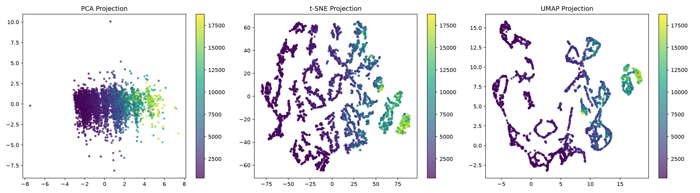

# Нейросетевые модели, категориальные эмбеддинги и снижение размерности (Dataset Diamonds)

## 1. Цель исследования

Исследовать возможности глубокого обучения для задач регрессии на табличных данных и применить методы многомерного анализа для визуализации скрытой структуры датасета **Diamonds** (`price`):
- Разработать гибридную архитектуру нейронной сети на **PyTorch**, использующую обучаемые слои эмбеддингов (`nn.Embedding`) для категориальных признаков и полносвязные слои (`MLP`) для числовых.
- Обучить модель, настроить гиперпараметры и зафиксировать метрики на отложенной тестовой выборке.
- Применить и сравнить нелинейные и линейные методы снижения размерности (**PCA**, **t-SNE**, **UMAP**) для визуализации распределения целевой переменной (`price`) в двумерном пространстве.

---

## 2. Архитектура нейронной сети (PyTorch MLP)

Для эффективной работы с категориальными признаками (`cut`, `color`, `clarity`) вместо стандартного One-Hot Encoding внедрены обучаемые эмбеддинги:
- Размерность каждого эмбеддинга определялась эвристическим правилом: $\min(50, \lfloor (\text{cardinality} + 1) / 2 \rfloor)$.
- Числовые характеристики (`carat`, `depth`, `table`, `x`, `y`, `z`) предварительно масштабировались через `StandardScaler`.
- **Структура сети**:
  - Входной слой: конкатенация векторов эмбеддингов и числовых признаков.
  - Скрытые блоки: Линейные слои (`Linear 128` $\rightarrow$ `Linear 64`), нормализация (`BatchNorm1d`), функция активации `ReLU` и регуляризация `Dropout` ($p = 0.2$).
  - Выходной слой: 1 нейрон для регрессии стоимости.

---

## 3. Результаты обучения и метрики качества

Обучение проводилось с использованием оптимизатора `Adam` (`lr = 0.005`, `weight_decay = 1e-4`), динамического планировщика скорости обучения (`ReduceLROnPlateau`) и функции потерь `MSELoss` на батчах размером 256.

### Метрики на отложенной тестовой выборке ($X_{test}$):
- **$RMSE$**: `558.12`
- **$MAE$**: `272.40`
- **$R^2$ (Коэффициент детерминации)**: `0.9814`

Нейросетевая модель с эмбеддингами показала высокую точность, сопоставимую с базовыми алгоритмами градиентного бустинга, успешно выучив нелинейные взаимодействия между категориями и геометрическими параметрами бриллиантов.

---

## 4. Снижение размерности и визуализация (PCA, t-SNE, UMAP)

Для анализа структуры многомерных данных на репрезентативной подвыборке (`5000` объектов) применены три метода проекции в двумерное пространство ($2D$), при этом точки окрашены в соответствии с целевой переменной (`price`):

1. **PCA (Метод главных компонент)**:
   - Линейное проецирование отражает общую глобальную дисперсию, показывая плавное возрастание стоимости бриллиантов вдоль главных осей (рост массы `carat`).
2. **t-SNE (t-Distributed Stochastic Neighbor Embedding)**:
   - Нелинейный метод выделил локальные кластеры и выраженные градиенты стоимости, сгруппировав камни со схожими характеристиками.
3. **UMAP (Uniform Manifold Approximation and Projection)**:
   - Сохранил как локальную, так и глобальную структуру многомерного многообразия, сформировав чёткие непрерывные траектории роста цены бриллиантов.

> ### Графики проекций (PCA, t-SNE, UMAP)
> 

---

## 5. Общие выводы

1. **Категориальные эмбеддинги**: Использование слоев `nn.Embedding` в PyTorch позволяет компактно и эффективно представлять табличные категории, улучшая обобщающую способность нейросети.
2. **Многомерный анализ**: Сравнение проекций (`PCA`, `t-SNE`, `UMAP`) подтвердило, что целевая переменная (`price`) имеет сильную геометрическую и нелинейную обусловленность в пространстве признаков.